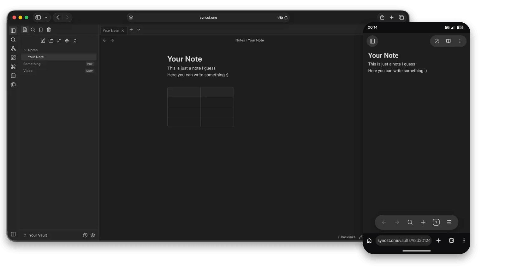

<p align="center">
  <a href="https://syncst.one">
    <picture>
      <source media="(prefers-color-scheme: dark)" srcset="assets/wordmark-dark.png">
      
    </picture>
  </a>
</p>

<p align="center">
  <strong>Your Obsidian vault on every device. Encrypted, always in sync.</strong>
</p>

<p align="center">
  <a href="https://syncst.one">Website</a> ·
  <a href="#install">Install</a> ·
  <a href="https://github.com/20Bosko07/syncstone-plugin/releases/latest">Latest release</a> ·
  <a href="https://github.com/20Bosko07/websync">Self-hosting</a>
</p>

<p align="center">
  <a href="https://syncst.one"></a>
</p>

# Syncstone for Obsidian

Syncs your Obsidian vaults end-to-end encrypted - with the hosted service at [syncst.one](https://syncst.one) (the
default) or with a **Syncstone server** you run yourself (see the [`websync`](https://github.com/20Bosko07/websync)
repository; switch it on under *Advanced* in the plugin settings).

- **Encrypted on your device.** The server only ever stores ciphertext.
- **Every device.** Desktop and mobile, plus your vault in any browser - no Obsidian needed.
- **Live collaboration.** Several people, one note, every cursor, in real time.
- **Sharing.** Share whole vaults or send a single note as a link.
- **History.** Version history, trash and restore.

## Install

**Community plugins (coming soon):** Obsidian -> Settings -> Community plugins -> Browse -> search for *Syncstone*.

**Today, with [BRAT](https://github.com/TfTHacker/obsidian42-brat):**

1. Install **BRAT** from Settings -> Community plugins -> Browse and enable it.
2. Open the BRAT settings, choose **Add beta plugin** and enter `https://github.com/20Bosko07/syncstone-plugin`.
3. Enable **Syncstone** under Settings -> Community plugins.

BRAT keeps the plugin up to date with the releases of this repository.

## Getting started

1. Open the Syncstone settings and press **Sign in in the browser**.
2. In the browser, sign in (or create an account at [syncst.one](https://syncst.one) - it starts with a free 14-day
   trial), approve the device and pick a vault.
3. Back in Obsidian, enter your vault passphrase once. Syncing starts.

**Make a backup first.** Sync tools can make mistakes. The plugin asks you to confirm that you have a backup of your
vault before it syncs anything.

Running your own server? Switch on self-hosting under *Advanced*, enter the address of your server's API and sign in the
same way.

## Disclosures (Obsidian developer policies)

- **Network use:** the plugin talks only to a Syncstone server: the hosted service by default, or the address of your own
  server if you switch on self-hosting in the settings. There is no telemetry, no analytics and no other third-party
  request.
- **Account required:** you need an account on a Syncstone server. Self-hosting is free; the hosted service is paid after
  the free trial.
- **No self-update:** the plugin never downloads or runs code other than what Obsidian installed.
- **Lost passphrase = lost data:** the encryption key is derived from your vault passphrase and never leaves your device.

## Development

```bash
pnpm install
pnpm dev          # esbuild watch -> main.js
pnpm build        # typecheck + production bundle
pnpm test         # tests of the shared crypto/protocol code
```

Copy `manifest.json`, `main.js` and `styles.css` to `<vault>/.obsidian/plugins/websync/` to try it.

### `shared/`

`shared/` is the crypto and wire-protocol code that the plugin and the Syncstone server must agree on byte for byte.
It is **copied** from the server repository, never edited here:

```bash
pnpm sync-shared ../websync
```

## Releasing

1. Bump `version` in `manifest.json` and add the version to `versions.json`.
2. Tag the commit with exactly that version (`git tag 0.1.1 && git push --tags`, no leading `v`).
3. The `release` workflow builds and attaches `main.js`, `manifest.json` and `styles.css` to a GitHub release.

The plugin `id` (`websync`) must never change once users have installed it.

## License

MIT, see [LICENSE](LICENSE). The copyright notice and the licence text must stay with every copy of the code.

The name "Syncstone", the logo and the syncst.one domain are not part of the licence: a fork needs its own name and logo.

---

<p align="center">
  <a href="https://syncst.one">syncst.one</a> · <a href="mailto:support@syncst.one">support@syncst.one</a>
</p>
